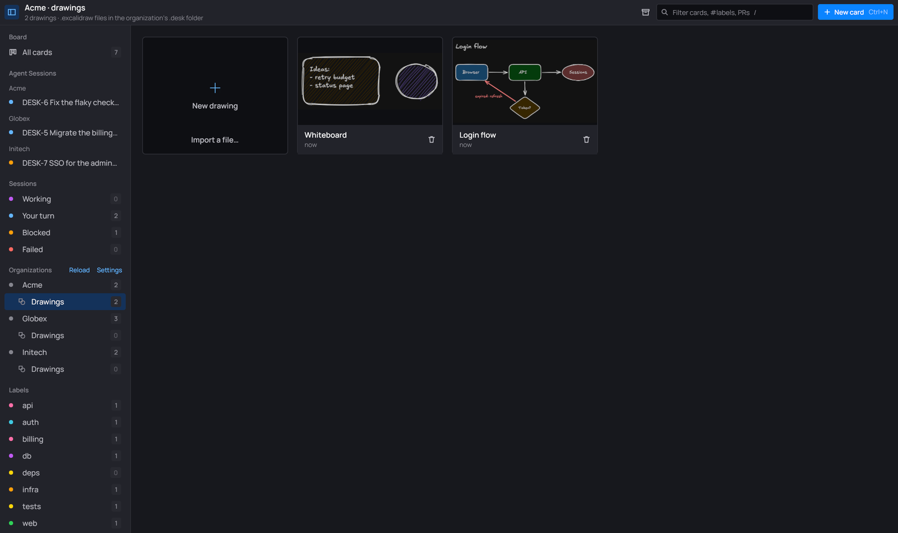
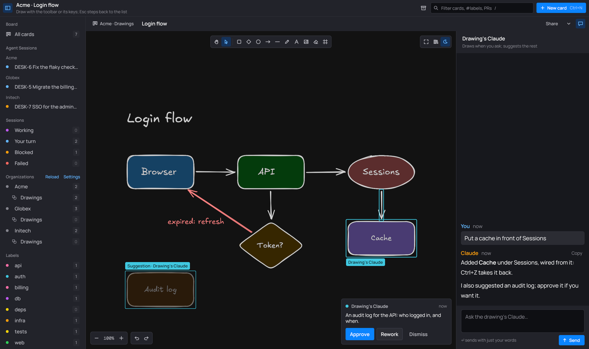

<div align="center">


# desk


**A Kanban board where every card is a Claude Code session.**<br>
Say what to do; Claude works on it in the right organization, under its own account, and asks you when it needs you.<br>
Pull requests, tickets, CI, alerts and the org's servers sit next to the work. `desk demo` shows it all with nothing to set up.

▶ [The 85-second demo, narrated](docs/desk-demo.mp4) · 📖 [**Documentation**](https://desk.domivega.com/)

[](https://github.com/lfdominguez/desk/actions/workflows/release.yml)
[](https://github.com/lfdominguez/desk/releases)
[](LICENSE)


[](#nix)
[](https://desk.domivega.com/)

[Features](#features) · [Install](#install) · [Getting started](#getting-started) ·
[Guide](#guide) · [Keys](#keys) · [Development](#development)

</div>

---

## Features

| | |
|---|---|
| 🗂️ **Board of sessions** | Backlog, To do, In progress, Blocked, Review, Done. Sessions move their own card: a message sends it to In progress, Claude reporting blocked to Blocked, done to Review. Only you move a card to Done. |
| 🏢 **Organizations** | Each org is a folder with its own `desk.toml`: its accounts, its Claude profile (sandboxed with bwrap on Linux, `CLAUDE_CONFIG_DIR` on macOS and Windows), its skills, its agents. |
| ✨ **Prompt optimization** | A new card's request is worked out by Haiku in the org's folder into a real brief: context, steps, acceptance criteria, labels, links and the skills to use. |
| 🔗 **Live links** | GitHub, GitLab and Bitbucket PRs/MRs and Jira issues on each card, with their state and CI. Tickets follow their card's column. |
| 🎫 **My tickets, CI, alerts** | Per org: tickets assigned to you, failing pipelines, and Nagios alerts. One click turns any of them into a card. |
| 🖥️ **Infra workspace** | Live SSH panes of the org's servers, from a plain OpenSSH config (or imported from Ásbrú), shared with an infrastructure Claude that asks before every change. |
| 💬 **Rich conversation** | Markdown with highlighted code, diffs of every edit, explained shell commands, subagents and background shells, permission prompts and interviews inline. |
| 🧑‍💻 **Full TUI too** | Any card opens in the real Claude Code TUI, inside desk, on the same session. |
| 🧭 **Workspace** | Each card's editor view: its projects' files in an editor beside a second Claude that reads them with you (never writes), answers the card's Claude, and opens any diff from the chat on the change. |
| ✏️ **Drawings** | Excalidraw diagrams per organization and per card, in desk's own editor. Every Claude can read and draw in them: edits show live and undo, and what you didn't ask for comes as a suggestion to approve. |
| 🔐 **Vaults** | Tokens from Bitwarden/Vaultwarden, Passbolt, env vars or a command. Unlocked keys stay in memory only. |
| 🪶 **No CLIs needed** | Every provider and vault is spoken to in Go. No `gh`, `glab`, `bw` or `wl-paste`. |

## Screenshots

Taken from `desk demo`: the organizations, tickets and servers are made up.

| | |
|---|---|
|  |  |
| **The board.** Every card is a session; Agent Sessions groups them by organization. | **Improve with Claude.** A one-line request becomes a brief: goal, context, steps, done when. |
|  |  |
| **The session.** Commands in plain words, subagents, every edit as a diff. | **Your turn.** Permission prompts and answers right in the conversation. |
|  |  |
| **Alerts.** Each organization's Nagios alerts, next to the work. | **Servers.** SSH panes shared with an infra Claude that asks before every change. |
|  |  |
| **Drawings.** Excalidraw diagrams for each organization and card, as `.excalidraw` files. | **Claude in drawings.** It draws when you ask and suggests the rest; every edit undoes. |

## Install

desk runs on **Linux under Wayland** (Hyprland, Sway, KDE, GNOME…; X11 is on the
[roadmap](#roadmap)), on **macOS 12+** (Apple silicon and Intel) and on **Windows 10/11** (x64).
It needs [Claude Code](https://docs.anthropic.com/en/docs/claude-code) (`claude`) on `PATH`.
Optional on Linux: `bwrap` ([bubblewrap](https://github.com/containers/bubblewrap)) for
per-organization Claude profiles (macOS and Windows hand the profile to Claude Code as
`CLAUDE_CONFIG_DIR` instead). The infra workspace speaks SSH itself (no `ssh` program needed).

> [!WARNING]
> **macOS and Windows are new and not fully tested.** desk is developed on Linux.
> - **Windows** was tested under Wine on Linux, not on a real Windows machine: the test suite
>   passes there, but some of it (PowerShell, console resizing, sockets) can't run under Wine.
>   The window was seen running under Proton (Steam's Wine, drawing through DXVK), until the
>   mouse moves over it: Proton's pointer input is incomplete and Gio, the UI toolkit, stops on
>   it. Plain Wine can't open the window at all. Real Windows has both.
> - **macOS** was tested in a QEMU macOS VM without a GPU: it builds and the test suite passes,
>   but desk's window needs Metal, so the GUI has never been seen running. It should work on a
>   real Mac.
>
> If something breaks on either, please [open an issue](https://github.com/lfdominguez/desk/issues).

### Windows

Download `desk-<version>-windows-amd64.msi` from the [latest release](https://github.com/lfdominguez/desk/releases/latest)
and run it: it installs to `Program Files\desk`, adds it to `PATH` (sessions run `desk peer`) and
puts desk in the Start Menu; a newer MSI replaces the old install. Or take the portable
`desk-<version>-windows-amd64.zip` and run `desk.exe` from anywhere. Neither is code-signed (see
[Roadmap](#roadmap)), so SmartScreen warns the first time: **More info → Run anyway**.

Terminals run on ConPTY; local shells are `pwsh`, else Windows PowerShell. Data lives where it does
on Linux, under `%USERPROFILE%` (`.config\desk`, `.local\share\desk`). Linux-only on Windows: the
infra workspace's virtual camera. From Linux, `packaging/windows/build.sh` cross-builds both files.

### macOS

Download `desk-<version>-macos.zip` from the [latest release](https://github.com/lfdominguez/desk/releases/latest)
(one universal `desk.app`), unzip it into Applications. It isn't signed with an Apple Developer ID
(see [Roadmap](#roadmap)), so open it the first time with right-click → **Open**, or clear the quarantine flag:

```sh
xattr -dr com.apple.quarantine /Applications/desk.app
```

From source, with Go and the Xcode command line tools: `packaging/macos/build-app.sh` builds
`dist/desk.app`. Run the app rather than a bare binary: macOS only shows an app bundle's
notifications. Data lives where it does on Linux (`~/.config/desk`, `~/.local/share/desk`).
Linux-only on macOS: the infra workspace's virtual camera (PipeWire / v4l2loopback).

### Nix

```sh
nix run github:lfdominguez/desk
```

Or add it to a flake:

```nix
inputs.desk.url = "github:lfdominguez/desk";
# …
environment.systemPackages = [ inputs.desk.packages.${pkgs.system}.default ];
```

### AppImage

Download `desk-<version>-x86_64.AppImage` from the [latest release](https://github.com/lfdominguez/desk/releases/latest):

```sh
chmod +x desk-*-x86_64.AppImage
./desk-*-x86_64.AppImage
```

### Debian / Ubuntu

```sh
sudo apt install ./desk_<version>_amd64.deb
```

### Arch Linux (AUR)

```sh
yay -S desk-kanban   # or paru, or: git clone https://aur.archlinux.org/desk-kanban.git && cd desk-kanban && makepkg -si
```

It builds the tagged release from source and installs `desk`. The AUR's `desk` is another program
(a shell workspace manager), so the two conflict. Claude Code itself is the AUR's `claude-code`.

### From source

Go (the version in `go.mod`), cgo, and the Wayland, xkbcommon, EGL and PipeWire headers:

```sh
CGO_CFLAGS_ALLOW=-fno-strict-overflow go build -tags nox11 -o desk ./cmd/desk
```

## Getting started

1. **Lay out your work as organizations.** By default desk looks in `$DESK_ROOT` (`~/Work`), two
   levels down: every subfolder is an organization (`~/Work/Acme`, `~/Work/Globex`…). Change the
   folders and depth in **Settings → General**, along with the languages cards are written in and
   Claude speaks with you in (English unless you change them; each new card can pick its own).
2. **Optionally give an org a Claude account.** A profile in `~/Secure/Claudes/<Org>/` makes that
   org's sessions run under it, sandboxed with bwrap (on macOS and Windows, with `CLAUDE_CONFIG_DIR` at it).
   Others use your own login.
3. **Optionally connect its accounts** in **Settings** (or by hand in `<Org>/.desk/desk.toml`, see
   [Links and organizations](#links-and-organizations)).
4. **Ctrl+N** for a new card: say what to do, pick the organization, **Improve with Claude**,
   **Create card**. The card starts working right away.

Just looking? `desk demo` opens a made-up board (Acme, Globex, Initech) whose Claude sessions,
tickets, CI, alerts and Globex's servers (with their infra Claude) are scripted: no accounts, no
SSH, nothing of yours read or written.

Everything is saved as you go: the board in `~/.local/share/desk/board.json`, conversations in
`~/.local/share/desk/chats/<card>.jsonl`, settings in `~/.config/desk/settings.toml`.

## Guide

### The board

- **Sidebar views**: all cards; sessions by status (working, your turn, blocked, failed, review); each
  organization and label in use; links (waiting on review, ready to merge, changes requested, open
  tickets); due (overdue, this week); the Done archive. Each shows its count.
- **Header**: the view in words, e.g. "2 working · 4 blocked · 1 overdue".
- **Cards**: key (`DESK-12`), status dot, organization, age; title; the status line with its
  reason ("Blocked by agent: waiting for PR #609"); link chips with their live state ("PR #609 ·
  approved — merge", "ABC-1317 · In Review"); the last message; labels, due date, and the
  session's turns, tokens and cost.
- **Review and Done**: a card Claude finishes waits in **Review** ("Ready for review") until you
  move it to Done; nothing else does. No view shows the Done column; Done cards show in
  **Done archive** with the archived ones: in sections by date or organization, filtered by chips
  (Done, Archived, organizations, top labels) and the search, a click previews a card beside the
  list (notes, numbers, last messages; Open session, Restore or Archive, Delete), and checkboxes act on
  many at once with one undo. The box in the toolbar archives every Done card.
- **My tickets**: under each organization with a Jira, GitHub or GitLab account, **Tickets** lists
  the open issues assigned to you there, by project. Click one to open its card, or to make one
  linked to it.
- **CI**: under each organization whose cards link pull or merge requests or commits, **CI** lists
  their GitHub Actions runs and GitLab pipelines; failed and running ones show their jobs. A PR or
  MR chip says its CI too ("approved — merge · CI failed" turns red).
- **Alerts**: under each organization with one or more `[[nagios]]`, **Alerts** lists hosts down
  or unreachable and services in warning or critical, errors first. Its count is the ones nobody
  acknowledged. desk reads Nagios Core's JSON CGI (`statusjson.cgi`, which XI serves too) with
  basic or digest auth, and falls back to a Nagios 3's `status.cgi` pages. An alert's
  **Investigate** makes it a card whose Claude has the infra Claude check the servers;
  **Snooze** (1 hour … 1 week, or your own `2h30m`) hides it until then.
- **Card tools**: every card's Claude has desk's read-only tools (`mcp__desk__*`): `alerts`,
  `tickets`, `link`, `ci` and `ci_log`, through the org's accounts. They add to the org's own
  workflow tools; Claude falls back to them when one of the workflow's fails. `add_project` and
  `ask_workspace` reach the card's workspace.
- **Right-click a card** for its menu: open its session, its full window or a window of its own, its terminal, its workspace, turn its
  Remote Control on or off, edit it, copy its key, move it to another column, archive it.
- **Desktop notifications** when a card turns to your turn, blocked, failed or ready for review, unless you're
  looking at it.

### Prompt optimization

The new-card dialog asks only **What to do** (as it comes, over as many lines as you like), the
organization, and **Improve with Claude** (Ctrl+J). The latest Haiku runs as Claude Code in the organization's
folder under its account, reading its CLAUDE.md files and code and changing nothing, and fills the
dialog as it streams: a title, the request worked out into the session's first message (context
found, steps, acceptance criteria, open questions), labels (the board's reused), priority, folder,
links and due date. It sees the skills, plugins, subagents and MCP tools that account's sessions
have, and has the session start with the ones that fit (a ticket → `/team-tools:work-ticket
ABC-510`). Tickets and PRs the request names are read first. The brief it follows is
[`internal/claude/optimizer.md`](internal/claude/optimizer.md).

Look it over, edit anything, then **Create**; **Ask again…** reruns it on what the dialog
holds now. What you wrote is kept: **Use mine** or **Discard suggestions** goes back to it.

- **Screenshots**: Ctrl+V of an image saves it beside the board and puts `` in the
  notes; the session reads it. desk reads images from the compositor itself (the Wayland
  data-control protocol: Hyprland, Sway, other wlroots compositors, KDE), on macOS from the
  pasteboard (⌘V), on Windows from the clipboard (a PNG or a screenshot's bitmap), nothing to
  install.
- **Tickets**: when the organization has somewhere to create them (its first `[[jira]]` project,
  else a `[[github]]` account's `repo`), the **Ticket** switch has the card's Claude create its
  ticket before any work, assigned to you, with the Markdown description converted to Atlassian's
  format by [go-adf](https://github.com/nyactl/go-adf).

### Sessions

Click a card (or Enter) to open its panel: the conversation, its links, and a box to message
Claude. Claude runs in `<Org>/<folder>` with `--permission-mode auto`, the organization's own
folder added with `--add-dir` so its `.claude/skills` load. Every Claude view names the account it
runs under.

- **Status lines**: Claude sets the card's state by ending a reply with `DESK-STATUS: blocked —
  <reason>` or `DESK-STATUS: done`, and attaches links with `DESK-LINK: <url>` (desk hides those
  lines). Done puts the card in Review, once nothing (subagent, background shell) is left running.
- **Questions and permissions**: Claude's interviews (AskUserQuestion) and tool permissions show
  as a box at the end of the conversation; the card goes to "your turn" meanwhile.
- **Shell commands**: a message starting with `!` runs it yourself with `bash` (PowerShell on
  Windows) in the card's folder, no Claude, no approval. Its output streams into the conversation, and when it ends
  Claude gets the command, output, exit code and time and carries on by itself.
- **Agent Sessions**: every card with a session is listed in the sidebar. Its full window shows
  the context meter and the account's plan limits (the 5-hour session, the week, a model's week).
- **A session in its own window** (the header's pop-out, the menu's Open in new window or
  **Ctrl+Shift+O**): just that card's session, its own message box and keyboard, while the board
  stays in the main window; closing it puts the session back, and it comes back when desk starts.
- **Subagents and background shells**: a bar under the header says what runs; **Show details**
  opens a rail with each one (model, task, tools, tokens, time) and their history. A held subagent
  says why: **Waiting on \<its shell\>**, **Running \<tool\>** over 30 s, **No activity** after 2
  minutes.
- **The canvas**: a card's full window draws its process as a node graph (Canvas | Conversation):
  the card, its tickets and the workspace Claude feed the session, the session hands work to its
  subagents and shells, its pull requests go to their CI and on to Done; each Claude shows where
  it is and what it's on. Pan, zoom, and click a node to open it.
- **File changes**: every Edit shows as a diff (unified, split or word diff, picked per block),
  over the code's highlighting. A Write shows its size.
- **Shell commands, explained**: Claude describes every command it runs in plain words;
  **Explain** has Haiku take it apart flag by flag.
- **Terminals**: **T** opens the card's session in the full Claude Code TUI inside desk (desk
  lets go of the chat's process first). It keeps running while you look at the board.
  **Remote** in its header (or **R** in the card menu) restarts it with Claude Code's Remote
  Control, to go on from claude.ai/code or the Claude app: the link and QR code show in the
  terminal. The chat's own process can't serve it (Claude Code offers it only in the TUI).
- **The workspace**: the header's **`</>`** (or the card menu's **W**) opens the card's projects
  (its folder, plus the ones its Claude adds with `add_project`, with an Undo toast) in a tree,
  files in tabs of a code editor (highlighting, line numbers, undo, **Ctrl+S** saves, reloads
  when Claude edits an open file), and a workspace Claude that only reads: what you have open,
  selected or the change you're viewing goes with your message, it suggests changes as diffs, and
  the card's Claude can ask it things (`ask_workspace`). A diff's **`</>`** opens the file on that
  change, marked in the gutter.
- **Artifacts** the session publishes are listed under the card's links.
- **Selecting text**: drag or double-click, copied as you let go; Claude's replies select with
  formatting kept, and **Copy** takes a whole reply as Markdown. The keyboard stays in the message
  box meanwhile.

### Drawings

Each organization has **Drawings** under its name in the sidebar, and each card its own (the
panel header's shapes icon): `.excalidraw` files in `<Org>/.desk/drawings/`, which excalidraw.com
opens too. A drawing opens in desk's editor, with Excalidraw's tools, keys and style panel
(rectangles, diamonds, ellipses, arrows that stay attached, lines, free hand, text, eraser), hand-drawn
or clean, light or dark; frames and groups; images from a file or the clipboard; the
organization's library (`library.excalidrawlib`); and copy and paste that goes both ways with
excalidraw.com.

- **Its Claude**: a chat beside the canvas with a Claude of the drawing's own, which reads the
  organization's files and draws only through desk's drawing tools. What you select goes with
  your message.
- **Every Claude draws**: card sessions, the infra Claude and each drawing's Claude get
  `drawings`, `drawing_read` (a picture and the element list), `drawing_edit` and
  `drawing_suggest`; the workspace Claude only reads and suggests. An edit shows live, outlined
  and named as that Claude's, and **Ctrl+Z** takes it back.
- **Suggestions**: a change nobody asked for floats over the drawing as a ghost, with **Approve**,
  **Rework** (your comment goes back to that Claude) and **Dismiss**.
- **Export, import, share**: PNG, SVG or `.excalidraw` through the save dialog; **Import a file…**
  takes an `.excalidraw` (a new drawing) or an `.excalidrawlib` (into the library); **Share** has
  the drawing's Claude publish it as a claude.ai artifact, and keeps the link.

### Links and organizations

Add links in the card's sheet (E): GitHub PRs and issues, Bitbucket PRs, GitLab MRs, Jira issues,
or bare Jira keys. Their state refreshes every 3 minutes through the organization's own accounts in
`<Org>/.desk/desk.toml`: any number of each kind. Edit them in **Settings** or by hand (the dialog keeps
keys it doesn't show, but not the file's comments). **Reload** looks for organizations again and
rechecks every link. desk keeps everything of its own in an org's `.desk/` (Claude Code's
`.claude/` and `CLAUDE.md` stay where they are); a `desk.toml` or `ssh_config` still at the org's
root from an older desk moves there by itself, and relative paths in them still start from the
org's folder.

A folder inside an organization can be one of its own: give it a `desk.toml` (e.g.
`~/Work/Acme/billing`). It is named after the folder, or by a top-level `org = "Billing"`, and its
sessions run under the outer org's Claude account.

**Tickets follow their card**: when a card moves column, its tickets you're assigned move to
match. A Jira issue takes the transition to the column's status category (Blocked: a status named
blocked; Review counts as in progress), a GitHub issue closes in Done and reopens out of it. Pull
and merge requests are left alone. At start and every 3 minutes, tickets that drifted are brought back in line.

desk only asks a provider through an account: a link whose organization has no account (with a
token) for its host and owner shows **no GitHub account** (or GitLab, Bitbucket) and is never
fetched, and its CI stays out of the CI view. Anonymous API calls would see no private repos and
run out fast (GitHub allows 60 an hour per address).

A token comes from a password vault item (`vault` + `item`, optionally `field`), an environment
variable (`token_env`) or a command (`token_cmd`). Vaults are Bitwarden, Vaultwarden and
Passbolt; desk asks for the master password the first time a link needs it and keeps it in memory
until it closes.

<details>
<summary><b>A full <code>desk.toml</code></b></summary>

```toml
agent = "planner"               # optional: the Claude Code agent new cards' sessions run as
agents = "meta/.claude/agents"  # where its agent files are, from this folder (default .claude/agents)

[[vault]]
name = "me"
kind = "bitwarden"              # Bitwarden or Vaultwarden
url = "https://vault.example.com"   # default https://vault.bitwarden.com
email = "me@example.com"
client_id = "user.1b2c…"        # optional: the account's API key, which skips 2FA
client_secret = { token_env = "BW_CLIENT_SECRET" }

[[vault]]
name = "globex"
kind = "passbolt"
config_file = "~/.config/passbolt/globex.toml"  # go-passbolt-cli's: server, key, passphrase, TOTP token

[[vault]]                       # or without a CLI config
name = "acme"
kind = "passbolt"
url = "https://passbolt.acme.com"
key_file = "~/.config/passbolt/acme.asc"   # your armored private key
# password = { token_env = "PASSBOLT_PASSPHRASE" }  # else desk asks

[[github]]                      # REST API; needs a token, like every account here
owners = ["globex-org"]
# repo = "globex-org/api"       # where cards create their issues (Ticket switch)
vault = "globex"
item = "GitHub token"

[[jira]]
url = "https://globex.atlassian.net"
email = "me@globex.com"
projects = ["ABC"]              # bare keys like ABC-12 link here; cards create their tickets in the first
# issue_type = "Story"          # what they're created as; default Task, else the first non-subtask
# sync = false                  # cards' column moves don't transition these issues
token_env = "JIRA_GLOBEX_TOKEN"
[jira.status]                   # optional: the status a column moves issues to, by name
Review = "In Review"            # cards waiting on your review put their issues there

[[bitbucket]]
workspace = "team"
user = "me"                     # app password; without user, token is a bearer token
token_cmd = "pass bitbucket/team"

[[gitlab]]
url = "https://gitlab.com"
groups = ["globex"]
token_env = "GITLAB_TOKEN"

[[nagios]]                      # as many as the org has: each one's alerts in its Alerts view
name = "prod"                   # what its alerts say they come from (default: its host)
url = "https://mon.globex.com/nagios"   # its web root, where cgi-bin/ is
user = "me"                     # the CGIs' login; the password is the token
vault = "globex"
item = "Nagios prod"

[servers]                       # optional: the org's servers file (below), from the org's folder
file = "infra/ssh_config"       # default .desk/ssh_config
```

</details>

### Servers

Under each organization with a servers file, **Servers** opens its infra workspace: session tabs,
live SSH panes with numbered command blocks, and the org's infrastructure Claude beside them,
which runs commands in those panes and waits for your approve / always / edit / deny on every
change (`[approvals]` in `desk.toml`). **Ctrl+Shift+K** is its palette: runbooks, files, forwards,
notes, reports, the health check, the audit log, recordings, sharing, broadcast.

A card of such an org hands server work to it with `desk peer`; the card shows **⇄ \<org\> infra**,
and the infra Claude's questions and results come into the card's conversation. Each card gets an
infra session of its own (tab **\<org\> · DESK-12**, its own Claude), so two tickets' server work
never mixes; its panes are the servers that one ticket needs. It can also write
to a card unasked or put follow-up work in To do. Claude Code users outside desk get the same
through the bundled plugin ([`plugin/`](plugin)).

An organization's servers are one real OpenSSH config, `<Org>/.desk/ssh_config` (or `[servers] file`).
desk connects with its own SSH client (Go, no `ssh` program), reading that file the way
`ssh -F <that file> <alias>` would, so the same command works from any terminal. Panes, the files
split (SFTP, or `sh`/`tar` on servers without it), the `changes` tool and port forwards share one
connection per server; questions (passwords, passphrases, yes/no) go to desk's ask box, a
`#@ password` from the vault first (read only once the server asks for a password). A pane that opens a new connection shows each of its steps
with its time (name lookup, connect, vault, key exchange, host key, each auth method, the shell),
so a slow connect says where the time went. Not supported: GSSAPI/Kerberos, host-based auth, PKCS#11 smart
cards, FIDO keys outside an agent, X11 forwarding, compression; the pane says so. desk's own data
are comment lines OpenSSH ignores, `#@ key value`:

<details>
<summary><b>An annotated <code>ssh_config</code></b></summary>

```sshconfig
# Before any "#@ group" or Host: the file's defaults.
#@ vault acme
#@ password "{user}@{host}"

# A section of the tree until the next "#@ group" ("/" nests); its #@ lines
# are the group's defaults (eu/web also takes eu's).
#@ group eu/web
#@ tags web, nginx
Host web1
    HostName 10.0.0.1
    User deploy
    # this host's own: host > group > parent groups > file
    #@ password "web1 root" password
    #@ wol 52:54:00:12:34:56 10.0.0.255:9
    #@ desc the public proxy
    # its name in Nagios (default: the alias and HostName)
    #@ nagios web1.example.com
    #@ pin
Host bastion
    # usable (ProxyJump), not listed
    #@ hidden
Host lab-pi
    # the password itself, no vault: your call (keep the file chmod 600)
    #@ password-raw "s3cret"

# Your own defaults last: ssh keeps the first value it finds.
Match all
    Include ~/.ssh/config
```

- Comments go on their own lines (`#@ desc a # b` keeps `a # b`).
- `password ITEM [FIELD]` fills `{host}`, `{user}` and `{group}` in ITEM and takes it from
  `vault`; `password-raw` is the password itself. The nearest level with either one wins.
- **A changed host key** (a reinstalled server, rotated keys) stops the connection. The pane's box
  then shows the key the server sent next to the one in `known_hosts`, by fingerprint. **Accept
  new key** (A) drops that line, saves the key shown and reconnects; it does nothing if the line
  no longer holds that key for that host.
- **Old algorithms**: a server offering only ones modern SSH turns off gets **Fix algorithms** (F),
  which writes `KexAlgorithms +…` (or `HostKeyAlgorithms`, `Ciphers`, `MACs`) into its Host block.
- **Includes** resolving inside the org folder count; ones outside it (like `~/.ssh/config`) are
  read when connecting but never listed, so your personal hosts never show as the org's servers.
- **Relative paths** (`IdentityFile`, `UserKnownHostsFile`, `Include`…) are from the folder of
  the file that holds them, not desk's working directory (nor `~/.ssh/` for `Include`, as `ssh -F`
  would take them).
- **Dynamic inventory**: `#@ hosts-cmd PATH` runs at start and on reload and keeps what it prints
  (ssh_config text or `name user@host:port` lines) in `<Org>/.desk/servers-dynamic.conf`
  (on Windows it runs through `cmd /C`: a `.bat`, `.cmd` or `.exe`).
- Every tab of the org works in `<Org>/.desk/infra/`: its Claude's cwd, with `runbooks/` and its
  `CLAUDE.md` (an older `<Org>/Infra-Claude/` moves there once). The servers file is the only
  source of servers: the old `Infra-Claude/<group>/` folders are no longer read.

</details>

#### Import from Ásbrú

Coming from [Ásbrú Connection Manager](https://www.asbru-cm.net/)? An organization's settings page
has **Import from Ásbrú** under its accounts: pick one of Ásbrú's top-level groups (the one that is
this organization's), or all of it, and its SSH connections are added to the org's servers file,
which is made if it has none. From a shell, the same is:

```sh
desk servers import-asbru -org ~/Work/Acme -group Prod   # add Prod's hosts to Acme's servers file
desk servers import-asbru > ssh_config                   # or just print the file
```

It reads `~/.config/asbru/asbru.yml` (or `$ASBRU_CFG`; give another file, such as an export, as the
last argument). Ásbrú writes that file when it closes cleanly, so close it before importing: while it runs, desk
refuses its file and says so (an export is read anyway).

- Groups become `#@ group` paths, relative to the group you picked.
- For each host it brings the address, user (the key's user for a key login), port and key.
- Jump hosts become hidden `Host` blocks behind `ProxyJump`, and a SOCKS proxy a `ProxyCommand`.
- The descriptions become `#@ desc`.
- Its ssh options (`-X`, `-A`, `-C`, `-o Key=Value`, `-L`/`-R`/`-D` forwards, `-p`, `-i`, `-l`, `-J`)
  become their config keywords. Anything else stays as a comment in the host's block.
- Algorithms desk's SSH client doesn't know (as OpenSSH 10, it has no `ssh-dss`) are left out of
  `HostKeyAlgorithms`, `KexAlgorithms`, `Ciphers`… with a comment, since one unknown name makes it
  refuse the whole file. `-` lists stay as they are.
- Passwords stay behind: an ssh_config can't hold them. Point `#@ password` at your vault instead.
- Connections that aren't SSH (RDP, VNC, Telnet…) are skipped, and so are hosts written with Ásbrú's
  variables (`<GV:…>`, `<ENV:…>`). The toast and the shell say which ones.
- A host the file already has (same address and port, under its name or the one it would get) is left
  as it is, so importing again only adds the new ones. A name the file gives another host gets the
  host's group in front (`acme-tracker`), even when you import one group at a time.

## Keys

| Do | How |
|---|---|
| Add a card | **Ctrl+N**, **New card**, or a column's **+** |
| Open a card's session | click it, or **Enter** on the selected card |
| Edit its fields | **E** |
| Its terminal | **T** |
| Move a card | drag it, or **Ctrl+arrows** |
| Select | **arrows** |
| Search | **/** or **Ctrl+F**: key, title, notes, org, links, `#labels` (fzf syntax) |
| Improve the request | **Ctrl+J** in the new-card dialog |
| Undo an archive or delete | **Ctrl+Z** |
| In the Done archive | **↑/↓** preview, **Space** check, **Ctrl+A** check all, **Enter** session, **Delete**, **Esc** uncheck |
| Back out | **Esc**: the dialog, the search, a field, the panel, then the selection |
| Text size | **Ctrl+=** bigger, **Ctrl+-** smaller, **Ctrl+0** back to 100%: the terminals and the session panel, anywhere |

Board keys work on the board only, not while you type in a field or in a dialog. A terminal takes
every key, Esc included, for Claude Code, except the text size's. A drawing has Excalidraw's keys
(tool letters and digits, Ctrl+C/X/V, Ctrl+G, Ctrl+D…): see the docs' Keys page.

## Development

[CONTRIBUTING.md](CONTRIBUTING.md) says how to report bugs and send pull requests;
[SECURITY.md](SECURITY.md), how to report a vulnerability privately.

```sh
nix develop                     # Go, cgo and the Wayland headers; or install them yourself
go test ./...                   # the dev shell sets -tags nox11
go run ./cmd/qa cover           # every package's coverage against its floor
go run ./cmd/qa mutate -file internal/ui/smart.go ./internal/ui   # mutation testing
```

**Releases** are dated, not semver (desk is an app, not a library): `2026.11.03`, and another
the same day `2026.11.03.1`, `.2`… Pushing such a tag builds the `.deb` and the AppImage and
publishes them; `desk --version` and the Settings say which one runs (a build between releases says
`dev-<commit>`). Every push to `main` also replaces the
[`nightly` pre-release](https://github.com/lfdominguez/desk/releases/tag/nightly) with that
commit's `.deb` and AppImage.

```sh
git tag 2026.11.03 && git push origin 2026.11.03
```

Point `XDG_DATA_HOME` and `DESK_ROOT` at scratch directories when running checks, never at your
real board. For screenshots and videos, `desk demo` runs in a fresh temp folder (board, settings,
organizations and `HOME` all inside it) with every provider faked, in a window titled `desk demo`. [CLAUDE.md](CLAUDE.md) has the package map and the conventions (it's written for
Claude Code, which builds most of desk, but reads fine for people).

## Vendored dependencies

desk's terminals (card sessions and SSH panes) run on charmbracelet's
[`x/vt`](https://github.com/charmbracelet/x/tree/main/vt) emulator and
[`ultraviolet`](https://github.com/charmbracelet/ultraviolet) cell buffer. Their released versions
copy every cell of the screen on each scrolled line, and drop the bottom of the screen when a pane
shrinks. A busy pane (a build log, `journalctl -f`) then costs seconds of CPU, and resizing a split
hides the prompt. Until upstream releases fixes, [`third_party/`](third_party) holds both modules
as published, with only the changes below, wired in by the `replace` block in `go.mod`. Their MIT
licenses are kept.

| Module | Function | Before | After | Measured | Upstream |
|---|---|---|---|---|---|
| ultraviolet | `Buffer.InsertLineArea` / `DeleteLineArea` | every cell of every line below is copied: O(width × height) per scrolled line | full-width areas rotate the row slices: O(height) pointer moves | one line on a 200×1000 buffer: 2.0 ms → 3 µs; `seq 1 300000` through a pane: 7.0 s → 1.0 s (80 cols), 15.2 s → 1.8 s (200 cols) | not fixed: [issue #214](https://github.com/charmbracelet/ultraviolet/issues/214), open [PR #215](https://github.com/charmbracelet/ultraviolet/pull/215) |
| x/vt | `Scrollback.Push` | a full scrollback drops its oldest line with `slices.Delete`, shifting all 10,000 lines | drops it by reslicing | one line into a full scrollback: 5.3 µs → 1.9 µs | not fixed: open [PR #888](https://github.com/charmbracelet/x/pull/888) (a ring buffer) |
| x/vt | `Emulator.Resize` | a shorter main screen cuts its bottom rows, where the prompt is | the top rows scroll into the scrollback first, as xterm does | behaviour fix | not fixed: [issue #1013](https://github.com/charmbracelet/x/issues/1013), open [PR #1019](https://github.com/charmbracelet/x/pull/1019) |

Each copy goes away once upstream releases its fix. [`third_party/README.md`](third_party/README.md)
has the versions copied.

## Roadmap

Planned, not there yet:

- **X11.** Gio, the UI toolkit, can draw on X11, but desk builds with `-tags nox11`, and pasting
  images reads the Wayland clipboard itself (`internal/clip`).
- **Apple signing and Homebrew.** macOS support is done (see [Install](#macos)), but the release's
  `desk.app` is only ad-hoc signed: signing it with a Developer ID and notarizing it needs an Apple
  Developer account, which the developer doesn't have and doesn't plan to get for now. The release
  workflow already has the signing steps, ready for when an account exists. No Homebrew cask yet
  either. The virtual camera stays Linux-only (PipeWire / v4l2loopback).
- **Windows code signing, winget and Scoop.** Windows support is done (see [Install](#windows)), but
  `desk.exe` and the MSI aren't Authenticode-signed, so SmartScreen warns: signing needs a code
  signing certificate, which the developer doesn't have and doesn't plan to get for now. The
  release workflow already has the signing steps (`WINDOWS_CERT_PFX`), ready for when one exists.
  No winget or Scoop package yet either.

## Acknowledgements

- [Gio](https://gioui.org) for the GUI, [charmbracelet](https://github.com/charmbracelet)'s
  `x/vt` and `ultraviolet` for the terminals (patched copies in [`third_party/`](third_party)),
  [goldmark](https://github.com/yuin/goldmark) and [chroma](https://github.com/alecthomas/chroma)
  for the conversation, [gvcode](https://github.com/oligo/gvcode) for the workspace's editor,
  [fzf](https://github.com/junegunn/fzf)'s matching algorithm for every
  search box, [go-adf](https://github.com/nyactl/go-adf) and
  [go-passbolt](https://github.com/passbolt/go-passbolt).
- Drawings follow [Excalidraw](https://github.com/excalidraw/excalidraw)'s file format and look:
  their hand-drawn strokes are a Go port of [rough.js](https://github.com/rough-stuff/rough)
  (MIT), and their outlines of [perfect-freehand](https://github.com/steveruizok/perfect-freehand)'s idea.
- Fonts: [Manrope](https://github.com/sharanda/manrope),
  [Geist Mono](https://github.com/vercel/geist-font) and
  [Excalifont](https://github.com/excalidraw/excalidraw), under the SIL Open Font License; the
  file icons are [Seti UI](https://github.com/jesseweed/seti-ui)'s font and colors, as VS Code
  ships them, under the MIT License.

## License

[MIT](LICENSE) © Luis Felipe Domínguez Vega
